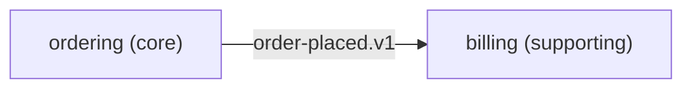

# Context map

Every bounded context, what kind of subdomain it is, who owns it, and how contexts relate. See `standards/architecture.md` for the patterns. Changing a relationship is an ADR.

## Contexts

| Context  | Subdomain  | Owner | Purpose                                |
| -------- | ---------- | ----- | -------------------------------------- |
| ordering | core       |       | Customers place and cancel orders.     |
| billing  | supporting |       | Invoices are issued for placed orders. |

## Relationships

| Upstream | Downstream | Pattern                                                                       | Contract                   |
| -------- | ---------- | ----------------------------------------------------------------------------- | -------------------------- |
| ordering | billing    | Open host service + published language; billing uses an anti-corruption layer | `ordering.order-placed.v1` |

